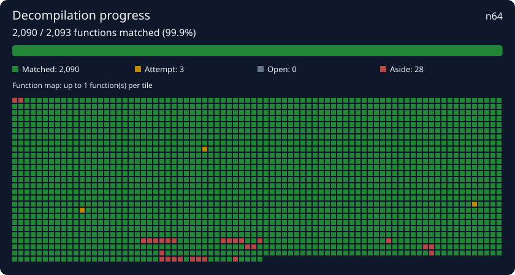

# V-RALLY-PAL: decompdecomp progress

This is a saved decompilation project created with [decompdecomp](https://github.com/n-delic/decompdecomp).
AI agents were used during the decompilation; their C attempts were kept only when decompdecomp's byte-for-byte
judge accepted them as matches.

## Project details

<!-- decompdecomp:details:start -->
- **Game:** V-RALLY-PAL
- **Platform:** n64
- **Compiler:** gcc-2.7.2-kmc
<!-- decompdecomp:details:end -->
<!-- decompdecomp:progress:start -->
- **Progress:** 2063 matching function(s), 42 best attempt(s)
- **Completion:** 2,063 / 2,087 functions (98.9%). 34 set aside, excluded from completion.
<!-- decompdecomp:progress:end -->

## What's in this folder

This folder is the whole of the work, and the only part of the project to share or keep in git. It holds no game
data: everything else in the project's folder was made from the game (the ROM, `asm/`, `assets/`, the build files)
and stays on your computer.

```
src/<function>.c      each matched function's C, byte for byte
best/<function>.c     the closest attempt so far at each function that doesn't match yet
include/common.h      the shared header every function is compiled with (common_<part>.h: a part's own)
decompdecomp.json     the game's fingerprint (its SHA-1, never the game), the compiler and its flags, the
                      functions' layout and names, notes, instructions, what agents learned, who matched what
README.md             this file
```

## Continue on another computer

Open decompdecomp, choose **New project → Open a saved project**, then pick this folder (or paste its git
repository's address) and your own copy of the game. decompdecomp checks it's the same game and judges every saved
function again: a match counts because it matches, not because a file says so.

## Collaborate

This folder is the source of truth. Edit its C, headers, names, notes or settings and pull or merge contributions
here. decompdecomp picks up changes automatically and judges changed code again. Deleted sources reopen their
functions. Keep git conflict markers out of these files; unresolved conflicts pause synchronization.

<!-- decompdecomp:visuals:start -->
## Progress map



Green: matched. Gold: attempted. Grey: open. Red: set aside. Functions follow address, then source unit and name order.
The image and tagged counts update on save. Keep project notes outside the hidden `decompdecomp` comment pairs to preserve them.
<!-- decompdecomp:visuals:end -->
